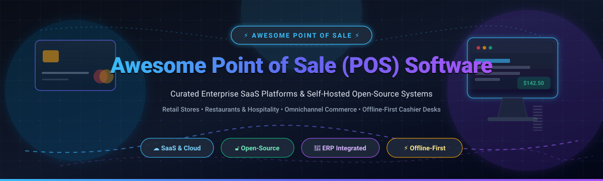

  

# 🛒 Awesome Point of Sale (POS) Software

  
  
  
  
  

> 🌟 A curated, SEO-optimized directory of top **Point of Sale (POS)** platforms, cloud-hosted SaaS billing engines, self-hosted open-source cashier systems, and retail inventory management solutions for shops, cafes, supermarkets, and restaurants.

---

## 📑 Table of Contents

- [🌐 Sector Overview & Market Dynamics](#-sector-overview--market-dynamics)
- [🟦 SaaS / Hosted Commercial Platforms](#-saas--hosted-commercial-platforms)
- [🟩 Open-Source Software](#-open-source-software)
- [📊 Comparison at a Glance](#-comparison-at-a-glance)
- [🛠 Selection & Architecture Guide](#-selection--architecture-guide)
- [🤝 Contributing](#-contributing)
- [⭐ Star History](#-star-history)
- [💖 Support](#-support)
- [📄 License](#-license)

---

## 🌐 Sector Overview & Market Dynamics

The global **Point of Sale (POS) software market** was valued at approximately **$12.5 billion in 2024** and is projected to expand at a compound annual growth rate (**CAGR) of 10.8% to surpass $22–$25 billion by 2029–2030**, driven by contactless digital payments, omnichannel retail unification, and cloud-native mobile POS (mPOS) terminals.

The market exhibits **moderate fragmentation across industry verticals with concentrated dominance at the mega-cap infrastructure layer**:
- **Retail & Omnichannel Commerce** is anchored by cloud giants like **Shopify** and **Block (Square)**, which capture substantial transaction volumes through bundled merchant acquiring and app stores.
- **Restaurant & Hospitality** demonstrates regional consolidation led by specialized players like **Toast**, while legacy hardware-heavy systems face accelerating migration toward hybrid-cloud solutions.
- Concurrently, a vibrant and resilient **open-source ecosystem** (powered by ERP-integrated suites such as **Odoo** and **ERPNext**, along with dedicated standalone stacks like **Open Source Point of Sale**) serves businesses prioritizing data sovereignty, local offline survivability, zero recurring SaaS seat licensing fees, and custom fiscal printer integration.

---

## 🟦 SaaS / Hosted Commercial Platforms

Leading enterprise and cloud-hosted commercial Point of Sale platforms, sorted in descending order by **company market valuation / annual revenue**:

| 🏢 Platform | 💰 Valuation / Revenue | 🏷️ Starting Tier Pricing | 🎁 Free Tier Limit / Free Trial | 🎯 Key Strengths | 🌐 Deployment Model |
| :--- | :--- | :--- | :--- | :--- | :--- |
| **[Shopify POS](https://www.shopify.com/pos)** | **$120B+ Market Cap** (~$8.9B+ ARR) | **$39 / month** (Shopify Basic billed monthly; $29/mo annually + 2.9% + 30¢ online / 2.7% card-present) | **3-day free trial** + $1/month promo for first 3 months; no permanent free tier | Omnichannel unified e-commerce & retail inventory across 1,000+ locations | Cloud SaaS (iOS / Android) |
| **[Clover](https://www.clover.com/)** | **$45B+ Parent Cap** (Fiserv, ~$20B ARR) | **$14.95 / month** (Payments Plus SaaS plan + 2.3% + 10¢ card transactions; hardware from $799) | **30-day money-back guarantee** / customized terminal demo trial; no permanent free tier | Deep integrated payment processing with proprietary touch hardware and robust third-party app ecosystem | Cloud SaaS + Dedicated Hardware |
| **[Square POS](https://squareup.com/)** | **$42B+ Market Cap** (Block, Inc., ~$22B ARR) | **$0 / month** (Square Free base plan; standard processing at 2.6% + 10¢ per tapped/dipped transaction) | **Permanent Free Tier** (unlimited transactions, items, locations; pay only transaction fees; Plus plans offer 30-day free trial) | Zero upfront software cost, instant onboarding, versatile mobile hardware, and comprehensive merchant services | Cloud SaaS (iOS / Android) |
| **[Toast POS](https://pos.toasttab.com/)** | **$18B+ Market Cap** (~$4.7B+ ARR) | **$0 / month** (Quick Start Starter Kit via pay-as-you-go processing) or **$69 / month** standard | **Permanent Free Starter Plan** (up to 2 terminals with pay-as-you-go transaction percentage); 30-day trial for add-on modules | Built-in restaurant table management, kitchen display systems (KDS), online ordering, and delivery dispatch | Cloud SaaS (Android Hardware) |
| **[Lightspeed POS](https://www.lightspeedhq.com/)** | **$2.5B+ Market Cap** (~$900M+ ARR) | **$89 / month** (Lightspeed Retail Basic billed annually; $109/month billed monthly) | **14-day free trial** with full feature access and product catalog setup; no permanent free tier | Advanced matrix inventory management, multi-store purchase ordering, and high-end boutique retail analytics | Cloud SaaS (iOS / Web) |

---

## 🟩 Open-Source Software

Self-hosted, developer-friendly, and community-maintained Point of Sale software, sorted in descending order by **GitHub Stars_Count**:

| 💻 Repository | ⭐ GitHub_Stars | 🧰 Technology Stack | 📜 License | 📝 Summary & Key Features |
| :--- | :---: | :--- | :--- | :--- |
| **[Odoo POS](https://github.com/odoo/odoo)** |  | Python / JavaScript / PostgreSQL | LGPL-3.0 | World-class modular POS integrated with comprehensive enterprise ERP, real-time inventory, accounting, and IoT Box hardware connectivity. |
| **[ERPNext POS](https://github.com/frappe/erpnext)** |  | Python / Frappe / MariaDB / Vue.js | GPL-3.0 | Full-featured ERP-integrated POS module featuring customer loyalty programs, multi-currency ledger, serial/batch tracking, and credit sales. |
| **[BTCPay Server POS](https://github.com/btcpayserver/btcpayserver)** |  | C# / ASP.NET Core / PostgreSQL | MIT | Self-hosted, censorship-resistant cryptocurrency and Lightning Network Point of Sale application with zero middleman fees and automated invoicing. |
| **[Open Source Point of Sale (OSPOS)](https://github.com/opensourcepos/opensourcepos)** |  | PHP / CodeIgniter / MySQL / Bootstrap | MIT | Lightweight, community-favorite web-based retail POS with stock inventory tracking, barcode generation, receipts, and multi-employee role access. |
| **[NexoPOS](https://github.com/Blair2004/NexoPOS)** |  | PHP / Laravel / Vue.js / Tailwind CSS | Open Source | Modern responsive web POS delivering granular inventory tracking, multi-register support, accounting reports, and restaurant kitchen extension modules. |
| **[Store-POS](https://github.com/tngoman/Store-POS)** |  | Electron / React / Express / SQLite | MIT | Modern cross-platform desktop POS client with fast touch cash register till, local LAN multi-terminal sync, visual photo catalog, and thermal receipt printing. |
| **[Lakasir](https://github.com/lakasir/lakasir)** |  | PHP / Laravel / Livewire / MySQL | MIT | Intuitive, straightforward cashier and point-of-sale management software tailored for small retail stores, kiosks, and food stalls. |
| **[TailPOS](https://github.com/bailabs/tailpos)** |  | Flutter / Dart / SQLite / ERPNext API | GPL-3.0 | Modern offline-first mobile Point of Sale app designed for tablets and smartphones with two-way ERPNext cloud synchronization. |
| **[POS Awesome](https://github.com/ucraft-com/POS-Awesome)** |  | Vue.js / Vuetify / Python / Frappe | GPL-3.0 | Sleek and highly responsive alternative POS frontend for ERPNext supporting offline order creation, cash drawer management, and barcode printing. |
| **[Laravel-POS](https://github.com/angkosal/laravel-pos)** |  | PHP / Laravel / Bootstrap / MySQL | MIT | Clean web-based point-of-sale and retail inventory application with order checkout, customer invoicing, supplier management, and sales summaries. |
| **[FloCafe](https://github.com/FreeOpenSourcePOS/FloCafe)** |  | Electron / SQLite / Node.js | MIT | Offline-first restaurant POS engineered for data sovereignty, featuring 131 country profiles, 109 currencies, multi-counter ordering, and KDS screens. |
| **[uniCenta oPOS](https://github.com/herbiehp/unicenta)** |  | Java / Swing / MySQL / PostgreSQL | GPL-3.0 | Battle-tested desktop POS with a 16-year legacy across hospitality and retail, renowned for extensive serial peripheral and cash drawer compatibility. |
| **[Floreant POS](https://github.com/floreantpos/floreantpos)** |  | Java / Swing / Embedded DB | MRPL-1.2 | Dedicated offline restaurant POS terminal featuring dining room table layouts, kitchen order ticket (KOT) routing, bar tabs, and tip calculations. |
| **[Open POS](https://github.com/onepiece92/openPOS)** |  | Flutter / Dart / SQLite / Riverpod | MIT | Offline mobile point-of-sale app and cash register for small shops, cafes and food trucks on Android and iOS, with product grid, held tickets, tables, customers, tax rates, PDF receipts, expense tracking and CSV export. Free, with no account, subscription or ads. |

---

## 📊 Comparison at a Glance

| 📦 Software Platform | ⚖️ Licensing | 🧱 Architecture | 📶 Offline Mode | 🏬 Multi-Location | 🔗 ERP Integration | 🖥️ Self-Hostable | 🎯 Best Fit |
| :--- | :--- | :--- | :---: | :---: | :---: | :---: | :--- |
| **Shopify POS** | Commercial SaaS | Cloud | ⚠️ Limited | ✅ | ⚠️ Via App | ❌ | Omnichannel e-commerce & physical store chains |
| **Clover** | Commercial SaaS | Cloud + Proprietary HW | ⚠️ Limited | ✅ | ⚠️ Via App | ❌ | Turn-key small business card payment terminals |
| **Square POS** | Commercial SaaS | Cloud Mobile | ⚠️ Offline Card Cache | ✅ | ⚠️ Via App | ❌ | Zero-overhead startup retail & mobile merchants |
| **Toast POS** | Commercial SaaS | Cloud Android | ⚠️ Offline Mode | ✅ | ⚠️ Via API | ❌ | High-volume restaurants, cafes, bars & food halls |
| **Lightspeed POS** | Commercial SaaS | Cloud | ⚠️ Limited | ✅ | ⚠️ Via API | ❌ | Complex retail inventory, apparel & boutique shops |
| **Odoo POS** | LGPL-3.0 / Commercial | Web + IoT Box | ✅ IoT Cached | ✅ | ✅ Native Deep | ✅ | Companies operating unified ERP, CRM & sales |
| **ERPNext POS** | GPL-3.0 | Web / Frappe | ✅ Sync Mode | ✅ | ✅ Native Deep | ✅ | Manufacturing & distribution firms running ERPNext |
| **BTCPay Server** | MIT | Web / Docker | ❌ Web-driven | ✅ | ⚠️ Webhooks | ✅ | Crypto-forward retailers demanding zero merchant fee |
| **OSPOS** | MIT | Web (PHP/MySQL) | ❌ | ❌ | ❌ | ✅ | Small mom-and-pop shops needing simple till setup |
| **Store-POS** | MIT | Electron Desktop | ✅ LAN Offline | ⚠️ LAN only | ❌ | ✅ | Fast desktop till for convenience stores & boutiques |
| **NexoPOS** | Open Source | Web (Laravel) | ⚠️ Web Cache | ✅ Multi-till | ❌ | ✅ | Tech-savvy businesses desiring customizable Laravel POS |
| **FloCafe** | MIT | Electron Desktop | ✅ Fully Offline | ⚠️ Multi-counter | ❌ | ✅ | Global restaurants requiring data sovereignty |
| **uniCenta oPOS** | GPL-3.0 | Java Desktop | ✅ Local DB | ⚠️ Manual Sync | ❌ | ✅ | Legacy standalone hardware with COM/serial peripherals |
| **Floreant POS** | MRPL-1.2 | Java Desktop | ✅ Local DB | ❌ | ❌ | ✅ | Dine-in restaurants seeking offline table & kitchen routing |

---

## 🛠 Selection & Architecture Guide

When choosing between cloud-hosted SaaS and open-source POS systems, consider these trade-offs:

1. **💳 Integrated Payments vs. Merchant Independence:**
   - Commercial SaaS platforms (Square, Toast, Clover) bundle payment processing directly into their pricing, which simplifies setup but can lead to vendor lock-in with non-negotiable interchange markups.
   - Self-hosted open-source systems allow you to negotiate interchange-plus rates with any local acquirer or accept Bitcoin/Lightning directly (e.g., via BTCPay Server) without recurring SaaS seat fees.

2. **📶 Offline Survivability & Network Latency:**
   - In high-throughput hospitality and retail environments, intermittent internet can halt checkout operations.
   - Desktop and local SQLite/LAN architectures (such as **Store-POS**, **FloCafe**, **uniCenta**, or **Odoo with IoT Box**) ensure checkout registers keep scanning and printing receipts even during ISP downtime.

3. **🔄 ERP Unification vs. Standalone Simplicity:**
   - If your enterprise demands automated ledger journal entries, batch serial tracking, and warehouse reorder points, adopting **Odoo POS** or **ERPNext POS** eliminates costly integration middleware.
   - For single-counter grocery stores or popup stalls, lightweight engines like **Open Source Point of Sale (OSPOS)** run comfortably on budget VPS environments with negligible maintenance.

---

## 🤝 Contributing

Contributions, software additions, and corrections are warmly welcomed! 

1. 🍴 Fork the repository.
2. 🌿 Create your feature branch (`git checkout -b feature/add-pos-tool`).
3. ✍️ Add the POS tool with verified GitHub_Stars, technology stack, license, and brief description.
4. 🚀 Open a Pull Request detailing the software's unique merits.

---

## ⭐ Star History

---

## 💖 Support

A massive **thank you** for checking out this repository! If this curated collection helped you discover the right Point of Sale tool, streamline checkout architecture, or save development hours, please consider showing your support:

- ⭐ **Star this repository** to help others discover it across GitHub.
- 🍴 **Fork and contribute** new open-source POS engines, plugins, and SaaS insights.
- 📢 **Share this list** with fellow founders, engineers, and retail/hospitality teams.
- ☕ **Buy me a coffee / become a sponsor**: Support ongoing open-source curation and maintenance at the [GitHub Sponsor Dashboard](https://github.com/sponsors/ishandutta2007).

---

## 📄 License

This compilation is licensed under the [Creative Commons Zero v1.0 Universal (CC0 1.0)](http://creativecommons.org/publicdomain/zero/1.0/) Public Domain Dedication. Listed platform trademarks, brand names, and software repositories belong to their respective copyright holders.

---

  ⭐ <b>Star this repository if you find it helpful for your business or tech stack!</b> ⭐

